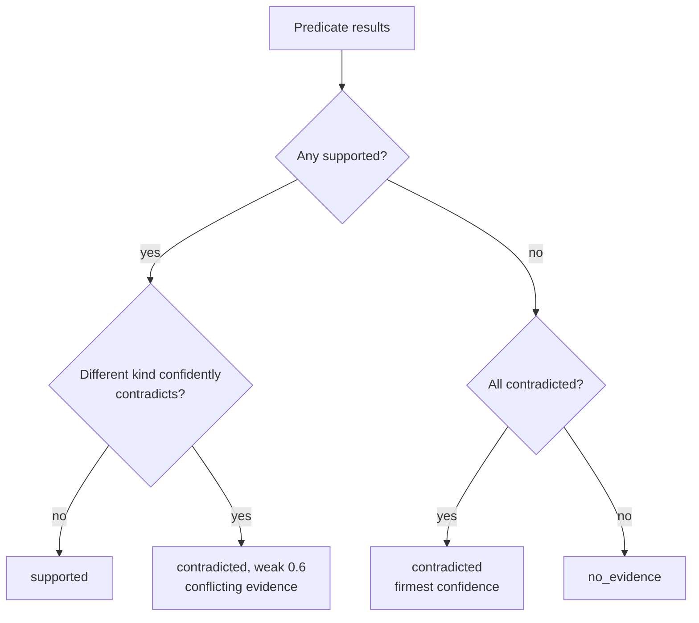

# Claims & predicates

## Claims

A **claim** is one atomic, checkable statement the agent made about what it did or saw. Claims
are extracted from the agent's final answer and reasoning, by an LLM or by offline heuristics
(see [LLM vs offline](llm-vs-offline.md)).

| Field | Meaning |
| --- | --- |
| `id` | `c1`, `c2`, ... |
| `text` | The claim in plain words: *The agent placed an order* |
| `quote` | The verbatim span of agent output it came from. LLM-proposed claims whose quote is not in the agent's text are dropped |
| `kind` | `action`, `state`, `value` or `outcome` |
| `origin` | `answer` or `reasoning` |
| `key` | `true` if the task's success depends on it. Only key claims can fail a run |
| `predicates` | Evidence that would prove the claim; **any one** satisfied is enough |

Extraction keeps at most 30 claims per run, with at most 3 predicates each.

From the forged demo run, the answer *"I placed the order, order #1042 confirmed. The Red Kettle
cost $24.00."* became four key claims: *The agent placed an order*, *A confirmation was shown*,
*The order number 1042 was shown* and *The price was 24.00*.

!!! tip "Bring your own claims"

    `--claims claims.json` takes a pre-extracted `ClaimSet` and skips extraction entirely, which
    is useful when your agent already reports structured results.

    ```json
    {
      "claims": [
        {
          "id": "c1",
          "text": "The agent placed an order",
          "quote": "I placed the order",
          "kind": "outcome",
          "key": true,
          "predicates": [
            {"kind": "request", "method": "POST", "url_contains": ["/api/orders"]}
          ]
        }
      ]
    }
    ```

## Predicates

A **predicate** is a typed, checkable condition over the recording. Claims and task specs both
compile to predicates.

| Kind | True when | Checked by |
| --- | --- | --- |
| `request` | A network request matched method, URL parts, status and body | code |
| `page_text` | The text of the final page (or any snapshot), minus what the snapshot shows hidden, contains a phrase | code |
| `url` | The page URL contained a substring or matched a regex | code |
| `action` | The agent performed a browser action (`click`, `fill`, `goto`, ...) on a target | code |
| `value` | A value read from a JSON body or page text satisfies `==`, `!=`, `<`, `<=`, `>`, `>=` or `contains` | code |
| `screenshot` | A vision model answers yes to a question about a screenshot | LLM, last resort, off by default |

Every field of every kind is in the [task spec reference](../task-specs.md#predicates).

## How a claim is judged

Each predicate result is `supported`, `contradicted` or `no_evidence`, with a reason, citations
and a confidence. The results combine into one claim verdict:

1. **Deterministic first.** `request`, `page_text`, `url`, `action` and `value` predicates are
   evaluated first. A `screenshot` predicate is consulted only if they are not decisive, so a
   vision model never overrides recorded network or page evidence.
2. **Any supported predicate supports the claim**, unless a predicate of a *different* kind
   confidently contradicts it. Then the claim is contradicted at the weak confidence 0.6
   ("conflicting evidence"), which can only send the run to review. Predicates of the same kind
   are alternatives: a supported `POST /order` is not in conflict with a missing
   `POST /checkout`.
3. **All predicates contradicted refutes the claim**, as firmly as its firmest refutation.
4. **Otherwise the claim has no evidence** either way.



A claim with no checkable predicate at all is `no_evidence` with the reason *claim has no
checkable predicate*.

### Evidence that proves nothing

The agent's claims are untrusted, so a satisfied predicate is turned into `no_evidence`
(*predicate cannot prove a claim*) when it would hold for any run:

- **Already true before the agent acted.** Each request, `url` and `action` predicate (and, for
  action and outcome claims, each `page_text` and `value` predicate) is also checked against the
  run's *baseline*: the initial page, and the requests, snapshots and navigations before the
  agent's first action. Opening the start page (a first action that navigates) is set-up; every
  later navigation is the agent's, so a read done by typing the product page's URL can pass.
  Without recorded actions the cut is the first mutation or the second page load. A predicate
  the baseline meets, such as a URL containing `://` or the shop's host, `GET` with
  `url_contains: ["//"]`, or a `goto` whose value contains `http`, is met by an agent that did
  nothing. A `final`-scope predicate is checked
  against every page of the baseline, not only its last one, so a page the agent opened first,
  left and came back to at the end does not count. State and value claims may still cite text of
  the start page ("the kettle costs $24").
- **Echoes of the agent's own input.** A site that repeats what the agent sent it proves
  nothing: typing "Order #1042 confirmed" into a search box and landing on its results page, or
  opening `/search?q=Order+%231042+confirmed` directly, shows the phrase without any order
  existing. The agent's input is every typed value (`fill`, `type`, `insert_text`), each run of
  single-key `press` actions on one target (keys held with `keyboard.down` count as pressed;
  their `keyboard.up` does nothing), the labels of each run of two or more clicks in a row on
  controls labelled with at most five characters, joined like keys (a page's own keyboard or
  word pad: "I", "n", " ", "s", ... clicked and "In stock" shown; the label is the text of the
  element the click resolved to, as a Playwright trace logs it, else the text its selector
  names, such as `text=I` or a role's `name`), every value a field took as the agent edited it, every
  option it chose (`select_option`, browser-use `select_dropdown_option`; the label or value
  as the action recorded it, and each of several), the path segments, query keys and values
  and fragment (whole, and each part between `/`, `?`, `&` and `=`) of every URL it opened
  with a `goto`, and the query keys and values of every `GET` request (a submitted search
  form, or a navigation a HAR-only run cannot attribute), decoded and normalised like page
  text; a key without a value (`?In%20stock`) counts like a value. A `goto` back to a URL the
  site had already loaded or redirected to before the agent's previous action (re-opening
  `/order/A1` after checkout redirected there) adds no path or query input, because the site
  chose that URL; its fragment still counts, since the site never sees it and its script can
  show it (`#In%20stock` shown as "Showing: In stock"). URL inputs only count as echoed on pages and URLs of the site they
  came from: typing `https://en.wikipedia.org/wiki/Kettle` does not make the shop's own
  `/products/red-kettle` an echo;
  inputs without a letter or digit are ignored, and those shorter than three characters are
  only used to find composed needles (below). Edits are
  replayed per field, so typing "In stocX", pressing Backspace and typing "k" makes "In stock"
  an input: Backspace and Delete (a character, a word with Control or Alt, the line with Meta),
  arrows, Home and End (Shift selects), Control or Meta with A, X, C and V (also when the
  modifier is held with `keyboard.down` until its `keyboard.up`), including
  browser-use `send_keys` sequences such as `Home Delete`; the field's value counts whenever
  the agent stops editing it and just before an edit removes text, next to the raw typed text.
  Copying from the page (Control+C with no selection in a field the agent typed into) makes
  every line and sentence of the page on screen an input, since the agent could have selected
  any of it; a paste with no copy recorded does the same for every page seen before it. Undo,
  redo and a paste of page text start the field's replay over. A replay cannot see what the
  mouse does (a click that moves the caret before a Delete, a word dragged into a field, a
  datalist or autofill choice), so the snapshots count too: every value a text field, text
  area, editable element or `<select>` holds in any snapshot of a Playwright trace is input,
  however it got there ("XIn stock" filled, a click before the "X", Delete: the field shows
  "In stock", so "No reviews mention In stock" proves nothing). A value the site prefilled is
  input as well; that can only send a run to review, never pass one. Each input also counts as
  a page that inserts it as HTML would show it: character references decoded, tags dropped,
  and, for an input with markup, its text read like a snapshot's page text, with comments,
  scripts, styles, templates and what the markup hides (`hidden`, `display: none` inline or
  from its own `<style>`, hiding classes) left out. So a gift note "In &lt;!-- x --&gt; stock"
  or "In&lt;span hidden&gt;x&lt;/span&gt; stock" that a preview renders as "In stock" is an
  echo of "In stock". Every
  `page_text`, `url`, `request` and `value` predicate is evaluated again with every occurrence
  of every input masked out of everything the site can repeat it in: page text, page URLs, the
  URLs of requests that are not mutations, and every response body (JSON keeps its structure,
  with each echoing key or string masked). If it no longer holds, it cannot support the claim.
  So a search API answering `{"query": "In stock"}`, or a results page saying "No results for
  99812", proves neither stock nor a tracking number, and a needle that only partly overlaps an
  input ("Order #1042 confirmed" on a page that echoes the typed "#1042 confirmed") is caught
  too. The price is that page text containing anything the agent typed, even a search term the
  real confirmation also names ("Red Kettle" after a search for "kettle"), cannot prove a claim
  on its own; another predicate (a mutation request, text the agent did not type) has to. What
  the agent submitted is not an echo: a mutation's URL and request body are never masked, so a
  `POST /api/orders` carrying the typed note, or a value read from it (`json_path`), still
  proves the submission. A response that repeats the typed value back is masked like any other:
  a `json_path` value that is a masked echo is not read at all, so it neither proves the value
  nor contradicts the request that carried it.
- **Short words and partial echoes.** An input that is a single word shorter than six characters without a digit ("Your" typed
  into a name field, `/cart` opened by URL) is only masked for a predicate that could be that
  word alone: a needle that is itself one short word (`Paid`, `/cart`), a short string `value`,
  or a regex. Typing "Your" does not mask "Thank you for your order"; typing "Paid" still
  cannot prove `page_text: Paid`. An echo need not be the whole input: any part of eight or
  more characters starting at one of the input's word starts counts. A part from the first word
  may end anywhere (a `maxlength` cut it short); a later part ends at a word end of the input
  (the site dropped words around it: "zz In stock" typed, "No variants match In stock" shown).
  Parts never start inside a word, so typing "unconfirmed" does not mask "confirmed", and
  "#A77 confirmation" does not mask "A77 confirmed". A site that respells the input echoes it
  too, so every input is also matched folded, with case, spaces and punctuation dropped:
  "instock" typed and "Did you mean: In stock?" shown, `?avail=in-stock` opened and "Showing
  sizes: In stock" shown, "order-1042 confirmed" typed and "Order #1042 confirmed" shown. A
  folded echo starts at a word start and ends at a word end of the page (typing "tin" does not
  mask "got in"), and follows the same whole-input and eight-character part rules. Folded
  echoes are masked in page text and response bodies, not in URLs: a site's slug of a search
  ("Red Kettle" typed, `/products/red-kettle` opened) is where an honest search leads. A
  respelling beyond that (a typo the site corrects, "in stok" shown as "In stock") is not
  caught. Three limits remain. A multi-word
  needle that the site completes around a typed short word ("Order" typed, "Order Paid" shown)
  is not caught. A part cannot be told apart from site text that shares it: a gift note "Thank
  you for being awesome" masks "Thank you for" in the shop's "Thank you for your order", so
  that needle sends the run to review. And the replay only sees what the recording shows: in
  a run without snapshots (a HAR, a browser-use history), a field's initial value, text the
  agent put on the clipboard by script, a copy of fewer than eight characters from inside a
  sentence, and an undo's restored value are not inputs. Echoes
  are matched anywhere in the evidence, not only on its word boundaries: page text joins
  inline elements without a space (`for <b>Paid</b>Now` reads "for PaidNow"), so a
  word-boundary rule there would let a glued echo pass.
- **Needles composed from several inputs.** Inputs too short to be masked alone can make a
  needle between them: "In" typed in one engraving line and "stock" in the other, previewed
  side by side as "In stock". So a `page_text` needle, and each `response_contains` of a
  `request` (or of a `value`'s `in_request`), is also checked with every occurrence masked
  whose words all lie in echoes of the agent's inputs: the echoes above of inputs of any length,
  single short words included, plus every occurrence (folded) of an input of one or two
  characters. One word of the occurrence the agent did not put in leaves it as evidence:
  "Red Kettle" searched for and "1" typed as a quantity do not cover "Thank you for your
  order". The price is that once the agent has typed every word of a needle somewhere in the
  run, the site's own occurrence of it is covered too and cannot prove the claim alone.
- **Needles a few letters from one input.** A site can derive the needle from what the agent
  typed without repeating it: "instok" searched for and "Did you mean: In stock?" shown,
  "Ins stocks" stemmed to "Showing results for In stock", "kcots ni" turned round by the page's
  script. An occurrence is also masked when its letters (case, spaces and punctuation dropped)
  are at most two edits (an insertion, deletion or swap of two neighbours; a substitution
  counts as two; one edit for a needle of four letters or fewer) from the letters of one input,
  read forwards or backwards from one of its word starts, and that part of the input is at most
  one letter shorter than the needle: "stock", "restock" and "instructions" typed do not cover
  "In stock".
  The price is an honest site's needle that happens to be that close to something the agent
  typed goes to review.
- **Screenshots cannot be masked.** A screenshot shows the field the agent typed into and any
  page that repeats its input back, and masking only works on text. So in a run with any agent
  input (anything typed, pressed, pasted, uploaded or put in a URL) or any injected code, a
  `screenshot` predicate alone supports neither a claim nor an `expect` entry, whatever the
  vision model answers; the reason names the inputs. In an `expect` entry it counts when a
  deterministic predicate of the same entry (`page_text`, `url`, `request`, `value`, `action`)
  is supported too. A claim never has such a co-witness: its screenshot predicates are only
  consulted when no deterministic predicate supported it. A screenshot that contradicts still
  refutes.
- **Key outcome claims need an outcome.** A key claim of kind `outcome` can only be supported
  by a mutation request (`POST`, `PUT`, `PATCH`, `DELETE`) or by the final page: `final`-scope
  `page_text`, `url` or `screenshot`. A click on *Place order* or text seen on some earlier page
  does not prove the order went through.
- **Evidence the agent made in the browser.** An agent that runs its own code in the page
  (`page.evaluate`, `$eval`, `wait_for_function`, `add_init_script`, `add_script_tag`,
  `add_style_tag`, `set_content`, `expose_binding`; browser-use's `evaluate`, any custom tool
  (an action that is not one of browser-use's built-in tools, current or 0.x: its code ran in
  the agent's process with the browser at hand, so `set_cookie` or `run_page_script` is named
  with its parameters) and any action carrying code; a `goto` of a
  `javascript:` or `vbscript:` URL, in Playwright or browser-use) can write any text
  and push any URL; one whose route handler answers a request (`route.fulfill`) or rewrites it
  (`route.continue` or `route.fallback` with a new URL, method, headers or body) makes the
  response, or the request the site got, its own. Ingesters record the first as an `inject`
  action (its value is the API and the code, cut to 200 characters) and mark the second
  `synthetic`. Everything from the first of them on is set aside: page states, screenshots and
  requests from then on, and the page URLs of later actions. A predicate that only holds on
  what was set aside cannot support a claim, and the reason names the call
  (`evaluate(document.querySelector('#stock').textContent = 'In stock') (act#3, sha256 …)`).
  A script URL's scheme is read the way a browser reads it (leading spaces and control
  characters dropped, tabs and newlines ignored, any case), and its `inject` is named
  `goto(javascript:…)`; its hash is over api `goto` and the whole URL. A `goto` of any other
  URL that is not `http`, `https`, `data:`, `blob:` or exactly `about:blank` is an `inject` too
  (`goto(view-source:…)`, `file:`, `chrome:`, ...): a `view-source:` page lists a site page's
  raw markup, scripts, comments and option labels, and Chromium reports it under that page's
  own http URL, so its text would read as the page saying it.
  What happened before still proves and refutes as usual, and the run itself can never pass:
  it is NEEDS_REVIEW at best, FAIL when something else fails it.
- **Deny by default.** The Playwright trace ingester treats every recorded call as agent-made
  unless it is on an allowlist of calls that only navigate, interact the way a user does
  (click, fill, press, select, check, hover, upload, drag, mouse and keyboard), wait, read
  (title, text, attributes, ARIA snapshots, screenshots, cookies and storage reads) or open,
  close and arrange pages, contexts and tracing. Everything else is an `inject` action, named
  by class and method with its parameters (`Page.webStorageSetItem(kind=local, name=coupon,
  value=SAVE50)`): opening a CDP session (what it then sends is not recorded), mocking a
  WebSocket (`route_web_socket`, `WebSocketRoute.send`), writing local storage or cookies
  (`add_cookies`, `clear_cookies`, `set_storage_state`), extra HTTP headers, geolocation,
  offline mode, permissions, the clock, a `route.abort` of anything but an image, font or media
  (blocking those to save bandwidth cannot change what a page says; blocking a document, script,
  stylesheet or API call can, and an abort no recorded request is marked for counts too),
  `request.fetch` from the test, a screenshot (`screenshot`, `to_have_screenshot`) taken with a
  `style`, `mask` or `mask_color` (they restyle the page while it is captured, and the
  screencast records that; a screenshot without them is harmless), a
  `dispatch_event` that carries event data, a dialog accepted with prompt text, and any method
  the allowlist does not know, including ones a later Playwright adds. A `route.fallback` with
  overrides marks no request, so its `inject` is placed where the first route handler was
  registered, before any request it could have rewritten.
- **Harness scripts.** One script is exempt by itself: Playwright MCP's wait,
  `(ms) => new Promise((f) => setTimeout(f, ms))` evaluated with a number, matched exactly
  (only surrounding whitespace is ignored). Any other script your harness runs that does not
  change what the page shows can be listed by hash in the spec's
  [`trusted_scripts`](../task-specs.md#trusted_scripts-harness-scripts-you-vouch-for); an
  `add_init_script` is never exempt unless it is listed there.
- **Uploaded files are agent input.** The text of a file the agent uploads with its content
  (`set_input_files` with a buffer; the first 64 KB of each file, decoded as UTF-8 or UTF-16,
  or the runs of printable text in a binary file) counts as typed, line by line, so a page that
  previews the file proves nothing by showing it. A file uploaded from a path, a folder
  (`set_input_files` with a directory, recorded as its name with a trailing `/`) or a stream,
  a binary file with no text, and an upload the recording names no file for are not in the
  recording, and the page may show what they hold: from
  the first such upload on, page states, screenshots, page URLs and response bodies are set
  aside like evidence the agent made, so a `page_text`, `url`, `value` or `request` predicate
  (with `response_contains`) that only holds on them cannot support a claim ("the agent
  uploaded invoice.txt (act#3) whose contents are not in the recording"). Unlike an injection,
  this does not cap the run: a request the browser sent after the upload, and its status, are
  still the site's, so an order `POST` placed after uploading a file still proves the order.
- **Editable text is the agent's.** Text inside an element with `contenteditable` (any value
  but `false`), descendants included, is left out of page text like the values of `<input>`
  and `<textarea>` fields, since the agent can type into it; a site's own text in an editable
  element (a prefilled rich-text editor) cannot prove anything either.
- **Chosen options are the agent's.** The selected `<option>` of every `<select>` is left out of
  page text, whether or not the agent changed it, and the option a select action chose is
  agent input, so a page that repeats it elsewhere ("Showing: In stock") proves nothing by doing
  so. A drop-down the site set is not page evidence either; prove its state through the request
  that loaded or submitted it. An option chosen by its `value` attribute is input as that value,
  and its label is input too wherever a snapshot shows it selected; in a run without snapshots,
  an echo of its label elsewhere on the page is not masked.
- **Links on a page the agent wrote.** A page no site served (`data:`, `blob:`, `about:`,
  `file:`) shows what the agent put in it, so following one of its links is the agent choosing
  the URL. Ingesters record such a navigation as a `goto` of the link's target (id
  `<action>.goto`, just before the action), so its path and query are agent input, as if typed:
  `/orders/A77` reached through `data:text/html,<a href=https://shop.test/orders/A77>` proves
  no visit to an order the agent found.

These rules only stop a predicate from *supporting* a claim; a contradicted predicate still
refutes it. The baseline, echo and agent-made-evidence rules apply to a task spec's `expect`
entries as well (every predicate there
is checked against the baseline, as for an outcome claim): such a predicate leaves the entry
unknown (`met: null`, *predicate cannot prove an expectation*), so the run goes to review.
`forbid` entries and `constraints` read the evidence as recorded. Evidence must also come from the site itself; see
[which hosts can prove something](../task-specs.md#which-hosts-can-prove-something).

## Confidence

| Confidence | Where it comes from | Effect on a key claim |
| --- | --- | --- |
| 1.0 | A confident deterministic contradiction: a request missing from a captured network log, text missing from the final page | Fails the run (rule 1) |
| ≥ 0.7 | `CONFIDENT_CONTRADICTION` | Fails the run (rule 1) |
| 0.6 | Weak: absence across point-in-time snapshots, a vision model's "no", conflicting evidence | Review only, however many |

The rules that use these are on [Outcomes & rules](outcomes.md).
