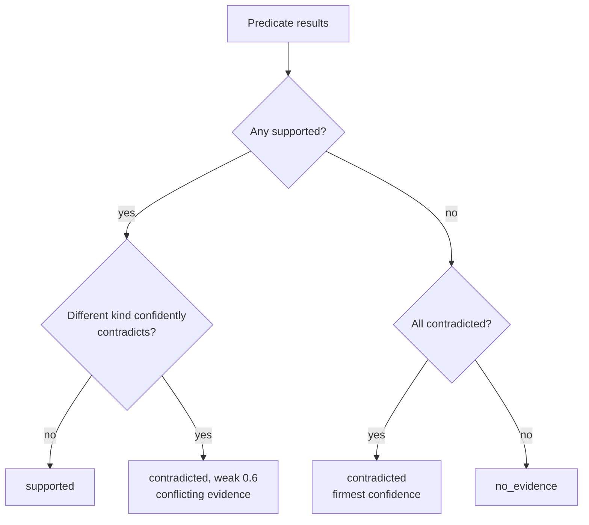

# Claims & predicates

## Claims

A **claim** is one atomic, checkable statement the agent made about what it did or saw. Claims
are extracted from the agent's final answer and reasoning, by an LLM or by offline heuristics
(see [LLM vs offline](llm-vs-offline.md)).

| Field | Meaning |
| --- | --- |
| `id` | `c1`, `c2`, ... |
| `text` | The claim in plain words: *The agent placed an order* |
| `quote` | The verbatim span of agent output it came from. LLM-proposed claims whose quote is not in the agent's text are dropped |
| `kind` | `action`, `state`, `value` or `outcome` |
| `origin` | `answer` or `reasoning` |
| `key` | `true` if the task's success depends on it. Only key claims can fail a run |
| `predicates` | Evidence that would prove the claim; **any one** satisfied is enough |

Extraction keeps at most 30 claims per run, with at most 3 predicates each.

From the forged demo run, the answer *"I placed the order, order #1042 confirmed. The Red Kettle
cost $24.00."* became four key claims: *The agent placed an order*, *A confirmation was shown*,
*The order number 1042 was shown* and *The price was 24.00*.

!!! tip "Bring your own claims"

    `--claims claims.json` takes a pre-extracted `ClaimSet` and skips extraction entirely, which
    is useful when your agent already reports structured results.

    ```json
    {
      "claims": [
        {
          "id": "c1",
          "text": "The agent placed an order",
          "quote": "I placed the order",
          "kind": "outcome",
          "key": true,
          "predicates": [
            {"kind": "request", "method": "POST", "url_contains": ["/api/orders"]}
          ]
        }
      ]
    }
    ```

## Predicates

A **predicate** is a typed, checkable condition over the recording. Claims and task specs both
compile to predicates.

| Kind | True when | Checked by |
| --- | --- | --- |
| `request` | A network request matched method, URL parts, status and body | code |
| `page_text` | The visible text of the final page (or any snapshot) contains a phrase | code |
| `url` | The page URL contained a substring or matched a regex | code |
| `action` | The agent performed a browser action (`click`, `fill`, `goto`, ...) on a target | code |
| `value` | A value read from a JSON body or page text satisfies `==`, `!=`, `<`, `<=`, `>`, `>=` or `contains` | code |
| `screenshot` | A vision model answers yes to a question about a screenshot | LLM, last resort, off by default |

Every field of every kind is in the [task spec reference](../task-specs.md#predicates).

## How a claim is judged

Each predicate result is `supported`, `contradicted` or `no_evidence`, with a reason, citations
and a confidence. The results combine into one claim verdict:

1. **Deterministic first.** `request`, `page_text`, `url`, `action` and `value` predicates are
   evaluated first. A `screenshot` predicate is consulted only if they are not decisive, so a
   vision model never overrides recorded network or page evidence.
2. **Any supported predicate supports the claim**, unless a predicate of a *different* kind
   confidently contradicts it. Then the claim is contradicted at the weak confidence 0.6
   ("conflicting evidence"), which can only send the run to review. Predicates of the same kind
   are alternatives: a supported `POST /order` is not in conflict with a missing
   `POST /checkout`.
3. **All predicates contradicted refutes the claim**, as firmly as its firmest refutation.
4. **Otherwise the claim has no evidence** either way.



A claim with no checkable predicate at all is `no_evidence` with the reason *claim has no
checkable predicate*.

### Evidence that proves nothing

The agent's claims are untrusted, so a satisfied predicate is turned into `no_evidence`
(*predicate cannot prove a claim*) when it would hold for any run:

- **Already true before the agent acted.** Each request, `url` and `action` predicate (and, for
  action and outcome claims, each `page_text` and `value` predicate) is also checked against the
  run's *baseline*: the initial page, and the requests, snapshots and navigations before the
  agent's first action that is not a navigation. A predicate the baseline meets, such as a URL
  containing `://` or the shop's host, `GET` with `url_contains: ["//"]`, or a `goto` whose value
  contains `http`, is met by an agent that did nothing. State and value claims may still cite
  text of the start page ("the kettle costs $24").
- **Echoes of the agent's own input.** A site that repeats what the agent sent it proves
  nothing: typing "Order #1042 confirmed" into a search box and landing on its results page, or
  opening `/search?q=Order+%231042+confirmed` directly, shows the phrase without any order
  existing. The agent's input is every typed value (`fill`, `type`, `insert_text`), each run of
  single-key `press` actions on one target, the path segments and query values of every URL it
  opened with a `goto`, and the query values of every `GET` request (a submitted search form,
  or a navigation a HAR-only run cannot attribute), decoded and normalised like page text;
  inputs shorter than three characters or without a letter or digit are ignored. A `page_text`,
  `url` or `value` (`page_regex`) predicate is evaluated again with every occurrence of every
  input masked out of page text and URLs; if it no longer holds, it cannot support the claim.
  So a needle that only partly overlaps an input ("Order #1042 confirmed" on a page that echoes
  the typed "#1042 confirmed") is caught too. The price is that page text containing anything
  the agent typed, even a search term the real confirmation also names ("Red Kettle" after a
  search for "kettle"), cannot prove a claim on its own; another predicate (a mutation request,
  text the agent did not type) has to. Values read from request bodies (`json_path`) are not
  masked.
- **Key outcome claims need an outcome.** A key claim of kind `outcome` can only be supported
  by a mutation request (`POST`, `PUT`, `PATCH`, `DELETE`) or by the final page: `final`-scope
  `page_text`, `url` or `screenshot`. A click on *Place order* or text seen on some earlier page
  does not prove the order went through.

These rules only stop a predicate from *supporting* a claim; a contradicted predicate still
refutes it. Evidence must also come from the site itself; see
[which hosts can prove something](../task-specs.md#which-hosts-can-prove-something).

## Confidence

| Confidence | Where it comes from | Effect on a key claim |
| --- | --- | --- |
| 1.0 | A confident deterministic contradiction: a request missing from a captured network log, text missing from the final page | Fails the run (rule 1) |
| ≥ 0.7 | `CONFIDENT_CONTRADICTION` | Fails the run (rule 1) |
| 0.6 | Weak: absence across point-in-time snapshots, a vision model's "no", conflicting evidence | Review only, however many |

The rules that use these are on [Outcomes & rules](outcomes.md).
